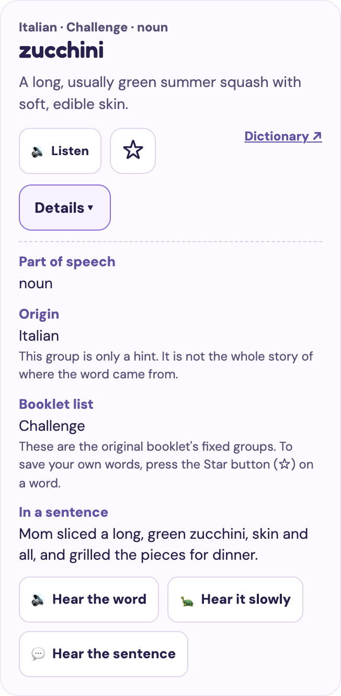

<div align="center">

# 🐝 Bee Ready

**Spelling bee practice for any speller. Hear a word, ask for clues, and spell it like a champion.**

[**▶ Open the live site**](https://gitchrisqueen.github.io/bee-ready-spelling/)

[](https://github.com/gitchrisqueen/bee-ready-spelling/actions/workflows/pages.yml)


</div>

---

## Contents

- [For spellers and grown-ups](#for-spellers-and-grown-ups)
- [Speech and voices](#speech-and-voices)
- [For developers](#for-developers)
- [Deployment](#deployment)
- [Repository layout](#repository-layout)
- [Testing and known limits](#testing-and-known-limits)
- [Content and license](#content-and-license)

## For spellers and grown-ups

Open the site, pick how many words you want, and start. There is nothing to install and no account to create.

| | |
|---|---|
| **1,155 words** | 911 Study words and 244 Challenge words, each with a definition and its language group. |
| **Random rounds** | Choose 5, 10, 15, 20 or your own number. Draw from all words, Study only, Challenge only, words you missed, or your starred words. |
| **Two ways to answer** | *Type the letters*, or *say it out loud* with a grown-up who reveals the spelling and marks it. |
| **Clues on request** | Ask for a definition, part of speech, language group or a sentence before you spell. The clue buttons stay available after you answer, and the sentence then shows the word in bold instead of a blank. |
| **Review missed words** | Words you miss are saved so you can practice them again. |
| **Star your own words** | Tap the ☆ on any word, in the word bank or during a round, to save it. Study and Challenge are the original booklet's fixed groups; the star is how you keep your own list. Filter the word bank to starred words only, or start a round from **My starred words**. |
| **Word details** | In the word bank, tap **Details** on any card to see its part of speech, language group, booklet list (Study or Challenge) and practice sentence. Buttons there let you hear the word, hear it slowly, or hear the sentence. Hearing it slowly does not change your saved talking speed. Cards start closed, and open cards close again if you reload the page. |
| **Natural voices** | Choose from four American English voices, adjust the talking speed, or use your device's own voice. Every word plays instantly from a recording. During practice, a single line under **Hear my word** shows the current voice and speed (for example "Sunny · Normal"). The **Voice and speed** button next to it opens a small panel with the four voices and the three speeds (Normal, Clear, Slow). Picking one saves it, the same as the Voices tab, and plays the word again. The panel starts closed on every page load and every new word, and stays open while you try several choices. **Repeat slowly** plays the word slowly once without changing the saved speed. |
| **Printable PDFs** | A practice workbook, an alphabetical list and a definitions reference. |
| **Phone and tablet ready** | The layout adapts to phones, iPads and desktops. |

<p align="center">
  
  
</p>

### Printables

- [Practice workbook](assets/Spelling_Bee_Practice_Workbook.pdf)
- [Alphabetical list](assets/Spelling_Bee_Alphabetical_List.pdf)
- [Definitions reference](assets/Spelling_Bee_Definitions_Reference.pdf)

### Your progress stays on your device

Practice history, starred words and voice settings are saved in your browser's local storage. The site never sends your practice to a server. (GitHub hosts the site and can see a visitor's IP address. If a grown-up turns on the optional live voice, files also load from cdn.jsdelivr.net, esm.sh and huggingface.co, which can see it too.) They are separate for each browser and each web address. Starred words are kept apart from practice history, so clearing one does not clear the other. The **Grown-ups** tab has buttons to clear practice history and to clear starred words. Voice settings have no clear button; they reset if you clear the site's data in the browser.

## Speech and voices

Every word, its practice sentence (the "In a sentence" clue), and the voice sample are recorded as short **clips** with the Kokoro neural voice by the clip workflow, so a recorded one plays almost at once. There is nothing to download first, and it works on any phone or tablet. Anything not recorded yet (a word or sentence that was just added or reworded) speaks right away with the device voice.

```
Recorded clip  →  live Kokoro  →  Piper  →  Device speech
  (instant)        (optional)     (backup)   (always works)
```

- **Recorded clips** cover every word in four American English voices: Sunny and Bella (female), Miles and Finn (male). Clear plays the same clip at 0.8× and Slow at 0.6× (pitch is kept). Pressing a speed on the Voices tab plays the sample so you can hear the difference.
- **No clip yet?** A word or sentence that has no recording yet (for example one just added or reworded) speaks right away with the **device voice**. A child never waits for a model.
- **Live voice (optional).** *Add live voice for new words* downloads the Kokoro model (about 90 MB, once) so new or reworded words and sentences (those without a recording yet) can be spoken in the natural voice. It can be slow on phones. If it fails, Piper and then the device voice take over automatically.
- **Device voice only** skips everything above and uses the browser's built-in voice.

**Good to know**

- The fonts (DM Sans and Fredoka, under the SIL Open Font License) are hosted in `fonts/`, so the page makes no request to Google or any other font service.
- The Kokoro model files are served from this site itself, with Hugging Face as a per-request fallback. The speech libraries (`kokoro-js`, the ONNX runtime) and the Piper backup load from third-party CDNs.
- No API key or subscription is used.
- Safari can ask for a second tap before it plays audio. The app shows a message when that happens.
- This is practice audio, **not an official competition pronunciation authority**. Check a dictionary for unfamiliar or ambiguous words.

## For developers

Bee Ready is a dependency-free static site: plain HTML, CSS and JavaScript modules. There is no framework, bundler or backend.

**Requirements:** Node.js 22 or newer for tests and the build. Python 3 only for the optional local server. No `npm install` step is needed.

```bash
git clone https://github.com/gitchrisqueen/bee-ready-spelling.git
cd bee-ready-spelling

npm test          # syntax checks, word-bank, starred-word, word-card, accessibility, contrast and workflow-rule tests, mocked voice tests
npm run build     # stages the deployable site into _site/
npm run serve     # serves the repo at http://localhost:8080/
```

To test the self-hosted voice model locally, run `npm run build && npm run fetch-voice-assets` and serve `_site/` (for example `cd _site && python3 -m http.server 8080`). Without that step, local development loads the model from Hugging Face instead.

You can also use any static file server. Open `index.html` through a server, not from `file://`, so the voice modules and `words.json` load.

### How it fits together

| File | Role |
|---|---|
| `index.html`, `styles.css`, `app.js` | Responsive UI, round logic, history and the word bank |
| `wordcard.js` | Builds the HTML for a word-bank card and its Details panel (part of speech, origin, booklet list, sentence, audio buttons). Pure functions with no DOM access, so they are tested without a browser |
| `stars.js` | Starred words: load, save, toggle and clear a set of word ids in `localStorage` (key `bee-ready-starred-v1`). Takes a storage object, so it is tested without a browser |
| `voice-service.js` | Recorded-clip playback, speech engine selection, on-demand model download, progress events, cancellation and fallback |
| `tools/clips/` | Clip generator (Kokoro + ffmpeg). Not part of the deployed site |
| `tools/pronunciation/` | Pronunciation audit: shortlists words likely to sound wrong. Not part of the deployed site |
| `tools/device-test/` | Mobile browser checks with real WebKit and iPhone/iPad presets. Not part of the deployed site |
| `fonts/` | The two web fonts and their license texts |
| `clips/` | Pre-recorded word and sentence clips, one folder per voice |
| `words.json` | The complete word data: id, word, part of speech, definition, language group, level, booklet page and practice sentence |
| `scripts/build.mjs` | Copies an allowlist of files into `_site/` |
| `scripts/fetch-voice-assets.mjs` | Downloads the pinned Kokoro model files into `_site/voice-assets/` and verifies every file's SHA-256 |

`speak()` takes an optional `speedId` (`normal`, `clear` or `slow`) that applies to that one call only. It never calls `select()` or writes `localStorage`, so the saved speed is unchanged; the word card's **Hear it slowly** button and the practice screen's **Repeat slowly** button use it. Do not turn either into a `select()` call.

`voice-service.js` exposes a small status object (`phase`, `engine`, `label`, `percent`, `detail`, `fallback`) that the UI subscribes to. That is what drives the download panel and the voice status line.

### Adding or changing words

Edit `words.json` (a word's practice sentence is its `sentence` field there) on a branch and open a pull request. When it merges to `main`, two things happen automatically:

1. The site deploys right away. New words and new sentences work immediately, spoken by the device voice.
2. The **Generate voice clips** workflow (`.github/workflows/generate-clips.yml`) records only the new or changed words and sentences, one parallel job per voice, opens a bot pull request titled "Update pre-recorded voice clips [skip ci]" that changes only `clips/`, merges it by itself once the `test` and `guard` checks pass, and then redeploys. Removed words and replaced sentences have their old clips pruned. It also runs when `sentences.js`, `voice-service.js` or `tools/clips/` changes, and you can start it by hand from the **Actions** tab.

The tests check that the list is well-formed (unique words, valid level, and every `sentence` contains its word exactly once), not that it has a particular size. The page reads the word count from `words.json`. A word's practice sentence is its `sentence` field, so when you add or change a word, write or update its sentence too; a changed sentence is recorded again, and a word without a `sentence` gets a generic fallback sentence. The number "1,155" in this README is a snapshot and is not checked.

**Safeguards.** The generator downloads the Kokoro model at one pinned revision and checks the model file's SHA-256 before it records anything. (The deploy step separately verifies every self-hosted voice file.) One failing word does not stop the run: finished clips are still put in the pull request and the run is marked failed. It refuses to delete more than 5% of a voice's clips without `--force-prune`, so an emptied `words.json` cannot wipe the clips. The workflow's `generate` job has a read-only token and runs npm with install scripts off. A separate `commit` job holds the write token (contents and pull requests), runs no npm code, accepts only validated `.mp3` files, per-voice `manifest.json` files and `settings.json`, and opens the pull request on a branch named `clips/update-<run id>`. The workflow token cannot push to `main` (see Deployment). A third small job, `start-deploy`, has no checkout and runs no npm code: it starts the required checks on that branch (events caused by the workflow token do not start workflows), turns on auto-merge, waits up to 40 minutes for the merge, and then starts the deploy and the scan on `main`. A manual run from any branch other than `main` does nothing.

To generate clips on your own machine instead:

```bash
ffmpeg -hide_banner -encoders | grep libmp3lame     # ffmpeg must include the MP3 encoder
cd tools/clips && npm ci
node generate.mjs                                    # all voices; only missing or changed clips
node generate.mjs --voice af_heart --limit 10        # try a few
node generate.mjs --prune                            # also delete clips for removed words
```

Needs Node 22 or newer, `ffmpeg`, a download of about 90 MB for the model (cached in `tools/clips/node_modules`), and about 136 MB of disk for the clips (measured: 9,244 clips, 136 MB or 129.8 MiB of audio; word clips average about 4 KB and sentence clips about 25 KB). Pull before you generate, and do not push local clips while the workflow is running, because both rewrite the manifests.

Voices are named by Kokoro id on disk: `af_heart` (Sunny), `af_bella` (Bella), `am_michael` (Miles) and `am_fenrir` (Finn). A clip is `clips/<voice id>/<key>.mp3`. A word's key is the word in lowercase ASCII: accents are dropped (`blasé` → `blase`) and any other character except `a-z`, `0-9` and `-` becomes `_`. A sentence's key is `sentence_` plus a hash of the exact sentence, so a clip can never play the wrong wording: if a sentence changes, its old clip is simply not found (the device voice speaks it) until the new one is recorded. To get a sentence's key (for `redo`), run `node -e "import('./voice-service.js').then(m=>console.log(m.sentenceKey(process.argv[1])))" "<the exact sentence>"`. Usually the easiest way to fix a bad sentence clip is to reword the sentence. The voice sample is `_preview`. The generator stops if two words would share a key. Each voice's `manifest.json` records a fingerprint of the text, voice, model revision and an `ENCODER` label. If you change the encoder filter, ffmpeg flags, model dtype, speed, model revision or `kokoro-js` version, the generator stops and asks you to bump the `ENCODER` label in `generate.mjs`, which regenerates every clip.

Timings, from my own measurements while building this (no logs are kept in the repo): a word clip takes 1.4 to 2.0 seconds for one process on a laptop and on two servers, and a sentence clip about 5 seconds (12 samples on a laptop), so roughly 30 to 40 minutes per voice for words and about 1.5 hours per voice for sentences. On GitHub's runners the first full sentence recording took 1 hour 15 minutes to 1 hour 25 minutes per voice, all four in parallel (workflow run 42162473625). Each voice runs in its own parallel job, so the wall-clock time of a full run is about one voice's time, and the total runner time is about four times that. A job stops cleanly after 280 minutes (a hard stop at 300; the job limit of 350 is headroom for saving), keeping what it finished.

**Check what a run would do:** `node generate.mjs --dry-run` prints how many clips each voice still needs, and how many stale clips a `--prune` run would delete, and exits without loading the model. On an up-to-date tree every voice shows `0` for both.

**Manual run options.** In **Actions → Generate voice clips → Run workflow** you can set `voice`, `limit` (stop after N new clips per voice, to split a big job or smoke-test), `redo` (clip keys to record again) and `force_prune` (allow deleting more than 5% of a voice's clips). `voice` is the Kokoro id (`af_heart`, `af_bella`, `am_michael`, `am_fenrir`), not the name shown in the app. Locally the same options are `--voice`, `--limit`, `--redo` and `--force-prune`.

**Fixing one bad clip.** Run **Generate voice clips** with `redo` set to the clip key (for example `blase`). Locally: `node generate.mjs --redo blase`, then commit the change. Recording again uses the same model, voice and settings, so it normally produces the same audio. If a word is mispronounced, re-recording will not fix it. The remedy would be a spelling override (for example a `say` field in `words.json` used as the speech text), which does not exist yet.

**Finding mispronounced words.** The voice guesses some loanwords wrong and nobody can listen to every clip. `tools/pronunciation/` shortlists the words most likely to sound wrong by transcribing the clips and comparing phonemes with a dictionary. It is a triage signal, not a verdict; see [tools/pronunciation/README.md](tools/pronunciation/README.md).

**Adding a voice.**
1. Add it to `VOICES` in `voice-service.js`, keeping the `kokoro:'id'` form (the workflow reads the list with that pattern; a test checks it). Fill in the `piper` backup voice too, and update the "four voices" wording in this README and the page.
2. Add its `voices/<id>.bin` to `scripts/fetch-voice-assets.mjs` with the size and SHA-256 from the pinned revision:

   ```bash
   f=$(mktemp) && curl -sSL "https://huggingface.co/onnx-community/Kokoro-82M-v1.0-ONNX/resolve/1939ad2a8e416c0acfeecc08a694d14ef25f2231/voices/<id>.bin" -o "$f" && wc -c < "$f" && shasum -a 256 "$f"
   ```
3. Open a pull request to `main` and merge it. Expect a full run for the new voice. A test fails if a voice is missing from either place, or if `clips/` has a folder for a voice that is no longer in `VOICES`.

**Removing a voice.** Remove it from `VOICES` in `voice-service.js`, remove its `voices/<id>.bin` row from `scripts/fetch-voice-assets.mjs`, and delete its folder in the same commit (`git rm -r clips/<id>`; this is the one allowed hand change under `clips/`). Without the delete, `npm test` and the commit job's validator both reject the leftover folder and the clip workflow stays red.

**Changing the encoder** (bitrate, filter, speed, model revision, `kokoro-js` version): edit the constants at the top of `tools/clips/generate.mjs`, bump `ENCODER`, try `node generate.mjs --voice af_heart --limit 3` and listen to the result, then open a pull request to `main`. Every clip is regenerated, which takes hours (the four voices run in parallel, so about one voice's time on the wall clock), and each regeneration adds roughly the full size of the clips (about 136 MB, measured) to git history, so consider splitting it with the `limit` option.

The commit job only accepts clips that fit its validator: at most 300,000 bytes per clip, at most 250 MB for the whole clips folder, a valid MP3 header, and nothing but `<key>.mp3`, `manifest.json` and `settings.json`. A much higher bitrate (about 136 MB at 40 kbps would be roughly 650 MB at 192 kbps) can pass the tests and the local trial and then be refused by the commit job after hours of work. Check the expected total first, and raise the limits in the workflow's validator together with the bitrate change.

The local trial (`node generate.mjs --voice af_heart --limit 3`) writes three clips plus that voice's `manifest.json` and `clips/settings.json` into your working tree. Open the three new clips in `clips/af_heart/` to listen, then commit them or run `git checkout clips` to discard. If you edit the constants and forget to bump `ENCODER`, the generator stops with a message asking for it.

### When a run fails

| What you see | What it means | What to do |
|---|---|---|
| `Model SHA-256 mismatch ... Refusing to generate` | The cached or downloaded model is not the pinned file. | Delete `tools/clips/node_modules/@huggingface/transformers/.cache` and run again. If it persists, the pinned Hugging Face revision may have changed or been removed. |
| `Bump ENCODER` | You changed a generator setting without changing the `ENCODER` label. | Bump `ENCODER` in `generate.mjs` (see above). |
| `refusing to prune N of M clips` | `words.json` lost more than 5% of its words, or you reworded many sentences at once, or a naming change made old files look stale. The run is red but still records new clips and keeps the old ones. | Check `words.json`. If the change is intended, run again with `force_prune`; otherwise stale clips pile up toward the 250 MB cap. |
| Run red with `Stopped at the --max-minutes limit` | A voice used its 280 minutes. Finished clips were saved in the pull request. | Run **Generate voice clips** again to continue. |
| Commit job warning `<voice> was not updated` and the run is red | That voice's files failed validation (for example a truncated manifest after a timeout). The other voices were still put in the pull request; this voice kept its old clips. | Run again; the voice is re-recorded from main. |
| `FAILED <voice>/<key>` and `N clip(s) failed` | Individual words failed. The run is red, but every good clip is still put in the pull request. | Find the words in the generate step log and run again; only the failed clips are retried. |
| Generate job red, commit job green | Expected after a partial failure: the finished clips went into the pull request. | Read the failed words in the log as above. |
| The generate step shows as cancelled or timed out, commit job green | It hit the 300-minute limit. Finished clips were saved in the pull request and deployed after it merged. | Run **Generate voice clips** again to continue: only missing clips are recorded (up to 24 per voice may be redone, because manifests save every 25 clips). Use `limit` to split a big job. |
| Commit job says `the clips folder would be larger than 250 MB`, `has an odd size`, `is not an MP3`, `unexpected file` or `unexpected entry` | The validator refused the files. Nothing was pushed. | Lower the bitrate, or raise the limit in the validator in `generate-clips.yml`, then run again. The artifact expires after 3 days. |
| `clips/ changed on main after this run started` | A change to `clips/` (for example a merged pull request) reached `main` while the run was generating. Nothing was pushed. | Run **Generate voice clips** again from `main`. |
| The `start-deploy` job is red with `Could not start pages.yml` or `Could not start denylist-guard.yml` | The pull request exists, but GitHub refused to start one of the checks (or, after the merge, the deploy or the scan). | Re-run only the `start-deploy` job (the per-job re-run button). It reads the pull request first and skips what is already done. Do not re-run the commit job: once the clips are on `main` it stops at the stale check, and before that it would only find the same pull request. If it is the deploy or the scan on `main` that did not start, you can instead open Actions → **Test and deploy Bee Ready to GitHub Pages** → **Run workflow** on `main`, and do the same for **denylist-guard**. |
| The `start-deploy` job is red with `Could not enable auto-merge` | The pull request exists and its checks were started, but GitHub refused to turn on auto-merge. | Open the pull request. Once `test` and `guard` are green, merge it by hand (the owner can merge it past the ruleset), then run **Test and deploy Bee Ready to GitHub Pages** and **denylist-guard** on `main`. |
| The `start-deploy` job is red with `A required check failed on the clip pull request` | `test` or `guard` failed on the clip pull request, so it will not merge. | Open the pull request from the link in the log and read the failed check. Either fix it on a branch and merge that, or close the pull request and run **Generate voice clips** again. |
| The `start-deploy` job is red with `The clip pull request did not merge in time` | The checks did not finish or the merge did not happen within 40 minutes. | Open the pull request. When the checks are green, merge it by hand, then run **Test and deploy Bee Ready to GitHub Pages** and **denylist-guard** on `main`. |
| **Generate voice clips** is green but the site lacks the new clips | The deploy it started failed or never ran. A bot-started run may notify nobody. | Open the latest **Test and deploy** run, read why it failed, and run it again on `main`, and run **denylist-guard** on `main` too (Actions → the workflow → **Run workflow**, branch `main`), because the merge push is skipped by `[skip ci]`. Do not re-run **Generate voice clips** or its commit job: once the clips are on `main` it stops at the stale check. If only `start-deploy` is red, re-run just that job, as in the `Could not start` row above. To see which commit is live, compare the `github-pages` deployment's commit (repository **Deployments**) with the head of `main`. After every clip run, open the deploy run it started. |
| The `guard` check (denylist-guard) is red | The scan found a tree or history hit. Its log prints a per-hash table of counts and never the matched text. It blocks every pull request, including a revert. | A tree hit: fix the text on a branch and open a pull request. A history hit needs the owner to clean the history. Only the owner regenerates `denylist.sha256` (it is built outside CI from a private list), so ask the owner. |
| `... would replace N (more than 5% fewer)` | The validator thinks an artifact would delete too many clips. | Run again with `force_prune` only if the removal is intended. |
| `audit.py: refusing to run, nothing was written` (pronunciation audit, run by hand) | An input is incomplete or not the pinned one: a `--limit` transcript file, missing words or clips, a wrong CMUdict checksum, or a `summary.md` without its markers. The committed outputs are untouched. | Read the listed problems and rerun the failed step, as in [tools/pronunciation/README.md](tools/pronunciation/README.md). To undo a bad write: `git checkout -- tools/pronunciation/flagged.json tools/pronunciation/scores.json tools/pronunciation/summary.md`. |

GitHub emails only the person who triggered a run, and a run that a bot starts may notify nobody. Check the **Actions** tab after merging a change to `words.json`, `sentences.js` or the voices. Deploys retry the Hugging Face download and keep a cache of the verified model files (keyed by revision and by a hash of the fetch script, so adding a voice saves a fresh cache), so a short outage does not block a deploy or a rollback. GitHub evicts caches that go unused for 7 days, so the first deploy after a quiet week downloads the files again. If the pinned model is ever removed from Hugging Face for good, upload the same files (same names, same bytes, same SHA-256) to a host you control and change the base URL in `scripts/fetch-voice-assets.mjs`, `tools/clips/generate.mjs` and the model rewrite in `voice-service.js`. If the files themselves change, update every pinned hash and bump `ENCODER`.

### Ownership and incidents

- **Owner:** the GitHub account `gitchrisqueen` owns and maintains this site.
- **Who watches it:** the owner checks the Actions tab after merging changes to words, sentences or voices. There is no separate alert channel.
- **Pronunciation audit:** the owner decides when to rerun `tools/pronunciation/` (after changes to words or voices) and what to do with a confirmed bad word; see its README, sections "Owner" and "Roll back".
- **Report a problem or a leak:** use the repository's Security tab → **Report a vulnerability** (private). The steps are in `.github/SECURITY.md`.
- **Emergency takedown, with no workflow needed:** Settings → Pages → **Unpublish site**. The repository and its history stay as they are; fix the problem, then publish again: set **Settings → Pages → Build and deployment → Source** back to **GitHub Actions** if it was cleared, then run **Test and deploy Bee Ready to GitHub Pages** on `main`.

### Data format

Each entry in `words.json` looks like this:

```json
{
  "id": 1,
  "word": "abdicate",
  "part": "v",
  "definition": "To give up a throne or an important responsibility.",
  "group": "Latin",
  "level": "Study",
  "scan_page": 15,
  "sentence": "<the practice sentence for this word>"
}
```

`level` is `Study` or `Challenge`. `group` is the language group from the source booklet, not a full etymology. `scan_page` is the page in the source booklet and is not shown in the app. `sentence` is the practice sentence read aloud by the "In a sentence" clue (with the word blanked on screen until the child answers, then shown in bold). It must contain the word exactly once, as a whole word. A word without a `sentence` gets a generic fallback sentence from `sentences.js`, so add one when you add a word.

## Deployment

`.github/workflows/pages.yml` runs on every push to `main`:

1. **Test:** `npm test`, then `npm run build`.
2. **Deploy:** builds `_site/`, adds the self-hosted voice model with `npm run fetch-voice-assets`, and publishes it with the official GitHub Pages actions.

The Kokoro model (Apache-2.0, pinned to one Hugging Face revision) is downloaded during the deploy and is **not committed to git**, which keeps the repository small. A checksum mismatch fails the deploy. Its license notice is published at `voice-assets/NOTICE.txt` on the site.

Pull requests run the tests only. The workflow can also be started by hand from the **Actions** tab. If a test fails, nothing deploys and the last good version stays live.

`generate-clips` keeps the recordings in sync with `words.json`. `denylist-guard` scans the tree and history on each push to `main` and on every pull request. Events caused by the workflow token do not start other workflows, so the clip workflow starts the `test` and `guard` checks on its pull request branch itself, turns on auto-merge, and, once the pull request has merged, starts the deploy and the scan on `main`.

**Branch ruleset.** `main` has an active ruleset named "main protection": changes must arrive by pull request, the checks `test` (in `pages.yml`) and `guard` (in `denylist-guard.yml`) must pass, and force-push and deletion are blocked. Only the repository owner can bypass it, and only through a pull request. The GitHub Actions app cannot bypass it (GitHub does not allow that on a personal repository), so the clip workflow goes through a pull request like everyone else. The workflow's own guards (it only runs on `main` and only touches `clips/`) stop accidents; the ruleset is the real barrier. To see or turn it off, open **Settings → Rules → Rulesets**. The repository settings that the clip workflow relies on are auto-merge, and **Settings → Actions → General → Allow GitHub Actions to create and approve pull requests**.

**Setup for a fork:** in **Settings → Pages → Build and deployment → Source**, choose **GitHub Actions**. Or run:

```bash
gh api -X POST repos/<owner>/<repo>/pages -f build_type=workflow
```

**Roll back:** open a revert pull request (`git revert <commit>` on a branch). Once it merges, the same workflow tests and deploys the revert. If a deploy is blocked and the site has to come down at once, unpublish Pages (see Ownership and incidents). Clip commits and clip pull requests carry `[skip ci]`, and a revert message copies it, which would stop the revert from deploying: delete `[skip ci]` from the revert commit message and from the revert pull request title. After the revert merges, check that a **Test and deploy** run exists for the new head of `main` (or start it from the Actions tab on `main`). Reverting a commit that only touches `clips/` does not start **Generate voice clips**. If you revert an encoder change: first cancel any running **Generate voice clips** run (Actions → the run → Cancel workflow; a cancelled run never opens a pull request), because the revert's own run queues behind it. Then revert the code commit and every clip commit made since (`git log --oneline -- clips` lists them; use `git revert -n <commit>` for each, then one commit and a pull request). Otherwise the next run regenerates everything.

To roll back the sentence clips themselves (revert the code that adds them): the old generator does not know their names and sees about half the clips as stale, so its 5% safety stops it from pruning. After the code revert, run **Generate voice clips** once with `force_prune`, or revert the clip commits.

## Repository layout

```
.
├── index.html · styles.css · app.js     UI and practice logic
├── stars.js                             Starred words (saved only in this browser)
├── wordcard.js                          Word-bank card and Details panel markup
├── voice-service.js                     Clips → Kokoro → Piper → device speech
├── sentences.js                         Sentence lookup and fallback templates (shared by the app and the clip generator)
├── clips/                               Pre-recorded word and sentence clips (4 voices)
├── fonts/                               DM Sans and Fredoka (web fonts) and their licenses
├── tools/clips/                         Clip generator and its dependencies
├── tools/pronunciation/                 Audit that shortlists words likely to be mispronounced
├── tools/device-test/                   Mobile browser checks (WebKit, iPhone and iPad presets)
├── words.json                           1,155-word data set
├── assets/                              Three printable PDFs
├── docs/                                README screenshots
├── scripts/
│   ├── build.mjs                        Stages the site into _site/
│   ├── fetch-voice-assets.mjs           Adds the verified voice model at deploy time
│   └── denylist_guard.py                Repository scanning helper
├── tests/                               Word-bank, starred-word, word-card, voice, accessibility, contrast and workflow-rule tests
└── .github/workflows/                   pages.yml, generate-clips.yml, denylist-guard.yml
```

## Testing and known limits

`npm test` runs the automated tests in `tests/`. The accessibility tests check markup and source for focus moves, status regions, fixed button names and wording; the contrast tests compute colour ratios from the stylesheet; the workflow-rule tests enforce the CI standard (see `CLAUDE.md`). The word-card tests check the labels, text escaping, sentence fallback, every part of speech and unique panel ids on generated markup; they do not click through the page. The starred-word tests check loading, saving, toggling and clearing against a fake storage object, including corrupt data and storage that refuses writes; they do not click through the page. The voice tests **mock** the network and speech playback. They cover recorded-clip playback and fallback, instant device speech when a clip is missing, the Kokoro → Piper → device order, cancellation, retry caching, and content checks such as unique words, ASCII clip names, and clip folders matching the voice list. They do not prove playback on a physical iPhone or iPad or in Safari.

### Mobile testing

`tools/device-test/` drives real **WebKit** (the engine Safari uses) with iPhone SE, iPhone 13, iPhone 14 Pro Max and iPad presets, in portrait and landscape, using touch taps. Serve the built site and run it:

```bash
npm run build && cd _site && python3 -m http.server 8080      # leave this running; use a second terminal below, then stop it with Ctrl-C
cd tools/device-test && npm ci && npx playwright install webkit
BASE=http://localhost:8080/ node device-test.mjs      # layout, tap targets, text size, flows; exit code 1 on a problem
BASE=http://localhost:8080/ node speed-check.mjs      # plays a word at Normal, Clear and Slow and prints the rates
BASE=http://localhost:8080/ node persist-check.mjs    # Repeat slowly, then the speed buttons in the voice menu: prints the rate of each play
BASE=http://localhost:8080/ node after-answer-check.mjs  # clue buttons after an answer (exits 1 on a mismatch)
```

It checks that the tab bar fits, that form fields are at least 16 px (iOS Safari zooms the page when you tap a smaller field), that tap targets are at least 44 px, that no text is under 12 px, that nothing overflows sideways, that the page makes no third-party requests, and that a practice round, the word-bank details and stars, and the speed buttons on the Voices tab work by touch. `device-test.mjs` also opens the practice screen's voice and speed menu, checks that it starts closed, opens, stays open after a choice and that Escape closes it and returns focus to the toggle, and runs the tap-target, text-size and overflow checks with the menu open. `persist-check.mjs` covers the menu and Repeat slowly end to end (it checks that the menu starts closed, opens, stays open while answering and closes at the next word, that each press plays exactly once at the right rate, and that the saved speed is right); it exits 1 on a mismatch. Both scripts are manual and are not run by CI, so no workflow guards this control. It is emulation on a desktop machine: it does not use iOS itself, a real speaker, the iOS audio rules, or a screen reader.

Manual checks, not part of CI, with no logs kept (my own observations; the mobile check above is repeatable): on the word-clips build I exercised a local build in desktop Chromium at a phone-sized viewport. All four voices played recorded clips, Slow speed played at its set rate, and a prefetched word started playing in 43 ms. I confirmed that every word had a clip in every voice, and sampled 120 clips for cut-off starts and ends. For sentences, a local build played a recorded sentence clip for one voice and fell back to the device voice for a voice without one, and after the first full sentence recording finished (workflow run 42162473625, success) I played a recorded sentence in each voice in the iPhone and iPad WebKit presets against the live site (an unlogged observation, like the rest of this paragraph). A check of recorded sentences on a real device is still open. I checked the model used for generation against the pinned SHA-256 on the three machines that generated clips. Real-device checks on iOS and iPadOS, including Safari's tap-to-play rule, are still open.

Other limits:

- The pronunciation audit in `tools/pronunciation/` is run by hand and is not part of CI. `npm test` only syntax-checks its scripts; nothing tests its scoring or the shape of `flagged.json` and `scores.json`. Its shortlist is a triage signal that nobody has listened to, not a verdict.
- Practice sentences are written for study, not taken from any competition, and are not official clues. A new word without its own sentence gets a generic fallback.
- Definitions are simplified study explanations, not dictionary entries. Competition rules and word lists vary by organizer.
- The language group is a label from the booklet. Many words passed through several languages.
- Typed answers are compared simply; accents and punctuation are not graded strictly.
- The words *learned* and *dogged* can be pronounced differently depending on meaning, so confirm with a grown-up.

## Content and license

Bee Ready is a standalone static app built from original spelling-bee study material and generated PDF references. The source scan is not included in this repository.

There is intentionally **no open-source license**. Viewing the code, word data and PDFs does not grant permission to reuse the underlying third-party source material.
