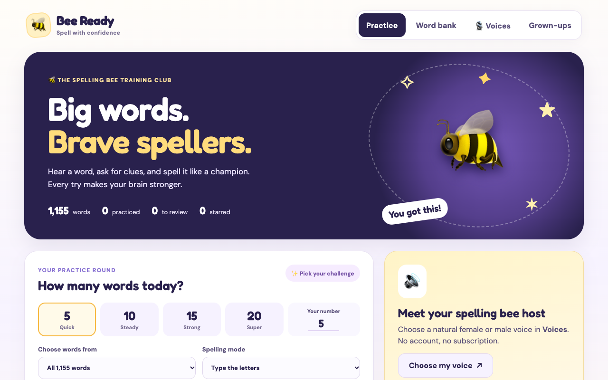
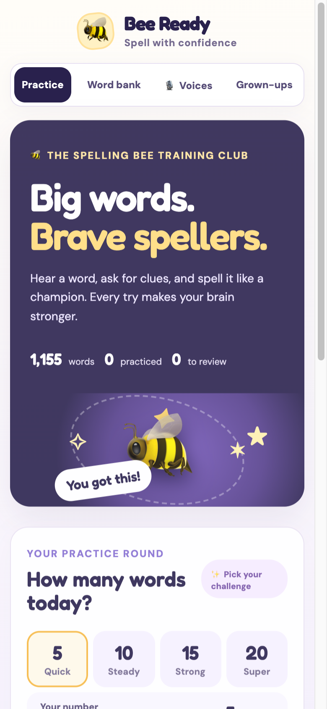

<div align="center">

# 🐝 Bee Ready

**Spelling bee practice for any speller. Hear a word, ask for clues, and spell it like a champion.**

[**▶ Open the live site**](https://gitchrisqueen.github.io/bee-ready-spelling/)

[](https://github.com/gitchrisqueen/bee-ready-spelling/actions/workflows/pages.yml)




</div>

---

## Contents

- [For spellers and grown-ups](#for-spellers-and-grown-ups)
- [Speech and voices](#speech-and-voices)
- [For developers](#for-developers)
- [Deployment](#deployment)
- [Repository layout](#repository-layout)
- [Testing and known limits](#testing-and-known-limits)
- [Content and license](#content-and-license)

## For spellers and grown-ups

Open the site, pick how many words you want, and start. There is nothing to install and no account to create.

| | |
|---|---|
| **1,155 words** | 911 Study words and 244 Challenge words, each with a definition and its language group. |
| **Random rounds** | Choose 5, 10, 15, 20 or your own number. Draw from all words, Study only, Challenge only, or words you missed. |
| **Two ways to answer** | *Type the letters*, or *say it out loud* with a grown-up who reveals the spelling and marks it. |
| **Clues on request** | Ask for a definition, part of speech, language group or a sentence before you spell. |
| **Review missed words** | Words you miss are saved so you can practice them again. |
| **Natural voices** | Choose from four American English voices, adjust the talking speed, or use your device's own voice. |
| **Printable PDFs** | A practice workbook, an alphabetical list and a definitions reference. |
| **Phone and tablet ready** | The layout adapts to phones, iPads and desktops. |

<p align="center">
  
</p>

### Printables

- [Practice workbook](assets/Spelling_Bee_Practice_Workbook.pdf)
- [Alphabetical list](assets/Spelling_Bee_Alphabetical_List.pdf)
- [Definitions reference](assets/Spelling_Bee_Definitions_Reference.pdf)

### Your progress stays on your device

Practice history and voice settings are saved in your browser's local storage. Nothing is sent to a server. History is separate for each browser and each web address, and the **Grown-ups** tab has a button to clear it.

## Speech and voices

Bee Ready tries three speech engines in order and moves to the next automatically if one fails.

```
Kokoro (neural)  →  Piper (neural backup)  →  Device speech
```

- **Kokoro** gives four American English voices: two female, two male.
- **Piper** is the backup. It has two speakers, so voices of the same gender share one backup.
- **Device speech** uses the browser's built-in voice and needs no download. You can choose it directly.

Natural voices download only when you ask for them (**Voices → Prepare natural voices**). A progress panel shows each model file as it downloads, and falls back to an indeterminate indicator when the library does not report totals. Browsers usually cache the files afterward when storage allows.

**Good to know**

- The first neural download needs an internet connection and is about 88 MB for the Kokoro model. The model files are served from this site itself (see below), so there is no third-party hop for the big download.
- The first playback can take a moment. Low-memory devices may fail to load a model, and Safari can ask for a second tap after a download. The app then falls back as described above.
- No API key or subscription is used. The speech libraries (`kokoro-js`, the ONNX runtime) and the Piper backup load from third-party CDNs, so their availability is outside this repository's control. If the site's own copy of the Kokoro model is missing, the app falls back to Hugging Face automatically.
- This is practice audio, **not an official competition pronunciation authority**. Check a dictionary for unfamiliar or ambiguous words.

## For developers

Bee Ready is a dependency-free static site: plain HTML, CSS and JavaScript modules. There is no framework, bundler or backend.

**Requirements:** Node.js 22 or newer for tests and the build. Python 3 only for the optional local server. No `npm install` step is needed.

```bash
git clone https://github.com/gitchrisqueen/bee-ready-spelling.git
cd bee-ready-spelling

npm test          # syntax checks, word-bank checks, mocked voice tests
npm run build     # stages the deployable site into _site/
npm run serve     # serves the repo at http://localhost:8080/
```

To test the self-hosted voice model locally, run `npm run build && npm run fetch-voice-assets` and serve `_site/` (for example `cd _site && python3 -m http.server 8080`). Without that step, local development loads the model from Hugging Face instead.

You can also use any static file server. Open `index.html` through a server, not from `file://`, so the voice modules and `words.json` load.

### How it fits together

| File | Role |
|---|---|
| `index.html`, `styles.css`, `app.js` | Responsive UI, round logic, history and the word bank |
| `voice-service.js` | Speech engine selection, on-demand model download, progress events, cancellation and fallback |
| `words.json` | The complete word data: word, part of speech, definition, language group, level |
| `scripts/build.mjs` | Copies an allowlist of files into `_site/` |
| `scripts/fetch-voice-assets.mjs` | Downloads the pinned Kokoro model files into `_site/voice-assets/` and verifies every file's SHA-256 |

`voice-service.js` exposes a small status object (`phase`, `engine`, `label`, `percent`, `detail`, `fallback`) that the UI subscribes to. That is what drives the download panel and the voice status line.

### Data format

Each entry in `words.json` looks like this:

```json
{
  "id": 1,
  "word": "abdicate",
  "part": "v",
  "definition": "To give up a throne or an important responsibility.",
  "group": "Latin",
  "level": "Study"
}
```

`level` is `Study` or `Challenge`. `group` is the language group from the source booklet, not a full etymology.

## Deployment

`.github/workflows/pages.yml` runs on every push to `main`:

1. **Test:** `npm test`, then `npm run build`.
2. **Deploy:** builds `_site/`, adds the self-hosted voice model with `npm run fetch-voice-assets`, and publishes it with the official GitHub Pages actions.

The Kokoro model (Apache-2.0, pinned to one Hugging Face revision) is downloaded during the deploy and is **not committed to git**, which keeps the repository small. A checksum mismatch fails the deploy. Its license notice is published at `voice-assets/NOTICE.txt` on the site.

Pull requests run the tests only. The workflow can also be started by hand from the **Actions** tab. If a test fails, nothing deploys and the last good version stays live.

A second workflow, `denylist-guard`, scans the tree and history on each push and pull request.

**Setup for a fork:** in **Settings → Pages → Build and deployment → Source**, choose **GitHub Actions**. Or run:

```bash
gh api -X POST repos/<owner>/<repo>/pages -f build_type=workflow
```

**Roll back:** `git revert <commit>` on `main` and push. The same workflow tests and deploys the revert.

## Repository layout

```
.
├── index.html · styles.css · app.js     UI and practice logic
├── voice-service.js                     Kokoro → Piper → device speech
├── words.json                           1,155-word data set
├── assets/                              Three printable PDFs
├── docs/                                README screenshots
├── scripts/
│   ├── build.mjs                        Stages the site into _site/
│   ├── fetch-voice-assets.mjs           Adds the verified voice model at deploy time
│   └── denylist_guard.py                Repository scanning helper
├── tests/                               Word-bank and voice tests
└── .github/workflows/                   pages.yml, denylist-guard.yml
```

## Testing and known limits

`npm test` runs 14 automated tests. The voice tests **mock** model downloads and speech playback, so they cover fallback order, cancellation, retry caching and content checks. They do not prove playback on a physical iPhone or iPad or in Safari.

Beyond the automated tests, the deployed site has been exercised in desktop Chromium: a real Kokoro download and playback, Piper taking over when Kokoro was blocked, device speech when both were blocked, and phone and tablet viewport widths with no horizontal overflow. Real-device checks on iOS and iPadOS are still open.

Other limits:

- Example sentences are generic study examples, not official competition clues.
- Definitions are simplified study explanations, not dictionary entries. Competition rules and word lists vary by organizer.
- The language group is a label from the booklet. Many words passed through several languages.
- Typed answers are compared simply; accents and punctuation are not graded strictly.
- The word *learned* and a few others can be pronounced differently depending on meaning, so confirm with a grown-up.

## Content and license

Bee Ready is a standalone static app built from original spelling-bee study material and generated PDF references. The source scan is not included in this repository.

There is intentionally **no open-source license**. Viewing the code, word data and PDFs does not grant permission to reuse the underlying third-party source material.
